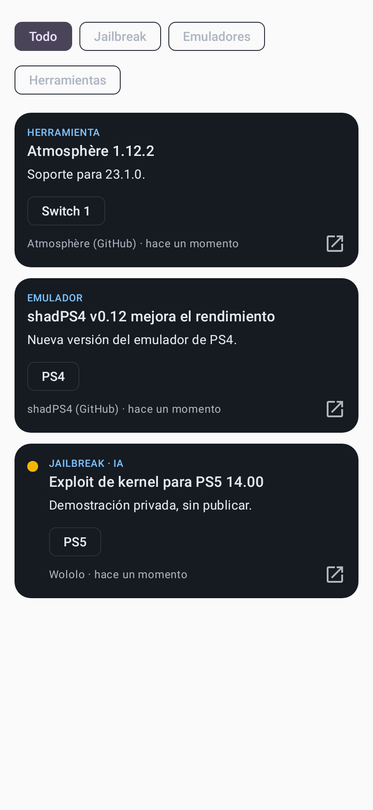
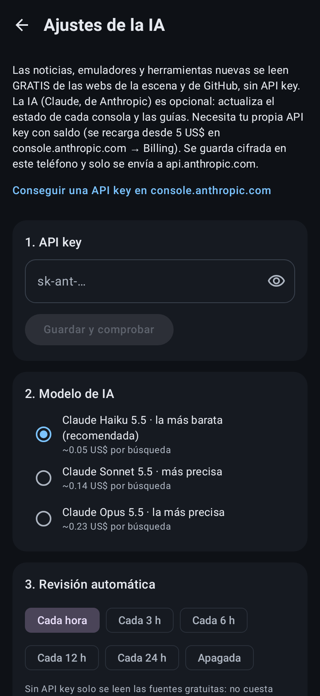

# Revisor de Jailbreak (app Android con IA)

App Android sencilla que te dice si tu consola se puede hackear según la marca, el modelo y el firmware, y te enseña cómo hacerlo con una guía paso a paso. Las noticias de jailbreak, emuladores y herramientas se leen **gratis** de las webs de la escena y de GitHub. Opcionalmente, una IA (Claude, con tu API key) actualiza los estados y las guías **desde el propio teléfono**, sin servidor.

| Inicio | Nintendo | PS5 + tu versión | Switch V2: solo modchip | Guía paso a paso |
|---|---|---|---|---|
|  |  |  |  |  |

| Noticias (jailbreak, emuladores, herramientas) | Ajustes |
|---|---|
|  |  |

## Cómo funciona

1. **Elige la compañía**: PlayStation, Nintendo, Xbox, SEGA o Atari, también con las consolas antiguas.
2. **Elige la consola**, por ejemplo Nintendo → Switch 2. Cada consola muestra su logo oficial.
3. **La app pregunta solo lo necesario**:
   - **PS1, PS2, NES, Wii…**: todas sus versiones se pueden hackear, así que **no pregunta el firmware**.
   - **Si el modelo importa, pregunta primero el modelo.** Por ejemplo, la **Switch V2, Lite u OLED** muestra directamente **"Solo con modchip, hay que abrirla"**, porque ningún firmware tiene hackeo por software. Solo la V1 parcheada pregunta el firmware.
   - En el resto, muestra la **lista de firmwares** con el color de cada uno al lado. También puedes **escribir tu versión** (por ejemplo `9.60`) para ver directamente el resultado.
4. Junto a cada resultado hay un botón **"Ver guía: cómo hacerlo"** con requisitos, pasos numerados, avisos y enlaces oficiales. Todas las guías están también en la pestaña **Guías**.
5. La pestaña **Noticias** muestra lo que encuentra la IA.

| Color | Significado |
|---|---|
| 🟢 Verde | Hay jailbreak o homebrew público y funcional. |
| 🟠 Naranja | Se puede, con condiciones: abrir la consola y soldar un chip, o solo en ciertos modelos. |
| 🟡 Amarillo | En desarrollo o incompleto (exploit parcial, no publicado o pendiente de actualizar). Siempre lleva una explicación. |
| 🔴 Rojo | No existe ningún método conocido. |

## Noticias gratis + IA opcional

La app tiene dos capas:

**1. Fuentes gratuitas (0 US$, sin API key).** Al pulsar ⟳ y en cada revisión automática, la app lee directamente:
- **Jailbreak**: Wololo, GBAtemp, Nintendo Life, r/SwitchHacks, r/ps5homebrew, r/ps4homebrew.
- **Herramientas**: nuevas versiones en GitHub de Atmosphère, Hekate, GoldHEN, etaHEN, PPPwn_cpp, Luma3DS, BadUpdate, Swiss y OPL.
- **Emuladores**: EmuCR, r/emulation, los blogs de Dolphin, PCSX2 y RetroArch, y las versiones de shadPS4, Vita3K, Azahar, PPSSPP, DuckStation, Cemu, melonDS, mGBA y xemu.

La lista está en `data/sources.json`. Cada noticia se etiqueta con su consola y su categoría, y la pestaña Noticias tiene filtros: Todo, Jailbreak, Emuladores y Herramientas.

**2. IA (opcional, de pago).** Usa Claude con búsqueda web, directamente desde el teléfono y con tu API key. Hace tres cosas:
- Actualiza el **estado (colores) de cada consola**.
- Encuentra noticias que no salen en las fuentes.
- **Actualiza las guías**. El botón "Actualizar todas las guías" (pestaña Guías), o "Actualizar esta guía" dentro de cada una, hace que la IA revise las páginas oficiales y reescriba los pasos, versiones y enlaces. Tarda unos minutos por guía y funciona en segundo plano.

Para activarla:
1. En <https://console.anthropic.com> crea una API key y **añade saldo** en Billing (desde 5 US$). Sin saldo la API responde "credit balance is too low" y la app avisa en español.
2. Pégala en **Ajustes** (⚙). Se guarda cifrada con el Android Keystore y solo se envía a `api.anthropic.com`.

Coste aproximado por búsqueda (sobre todo por las búsquedas web, ~0,01 US$ cada una):

| Modelo | Por búsqueda | Revisión diaria | Actualizar las 21 guías |
|---|---|---|---|
| **Claude Haiku 5.5** (por defecto) | ~0,06 US$ | ~0,6 US$/día | ~1,9 US$ |
| Claude Sonnet 5.5 | ~0,14 US$ | ~1,6 US$/día | ~3,5 US$ |
| Claude Opus 5.5 | ~0,23 US$ | ~2,6 US$/día | ~5,5 US$ |

Con 5 US$ y Haiku tienes para unos 8 días de revisión diaria o 2 actualizaciones completas de guías. Puedes elegir la frecuencia (cada 1, 3, 6, 12 o 24 horas, o apagada). Las fuentes gratuitas no cuestan nada con ninguna frecuencia.

Cada respuesta de la IA se valida antes de guardarse (versiones en orden, cada modelo cubierto, solo enlaces https y guías con pasos completos). Si algo no cuadra, se conservan los datos anteriores.

## Conseguir el APK

- **GitHub Actions**: cada push que toca `jailbreak-checker/` compila la app. En **Actions → Jailbreak Checker**, descarga el artefacto `revisor-jailbreak-apk` e instala `app-release.apk` (hay que permitir "instalar apps desconocidas").
- **En tu PC** (JDK 17+ y Android SDK):

```bash
cd jailbreak-checker/android
./gradlew assembleRelease   # → app/build/outputs/apk/release/app-release.apk
```

Para que las actualizaciones se instalen encima sin desinstalar, firma siempre con la misma clave. Para ello crea los secretos `ANDROID_KEYSTORE_BASE64`, `ANDROID_KEYSTORE_PASSWORD`, `ANDROID_KEY_ALIAS` y `ANDROID_KEY_PASSWORD` en GitHub.

## Estructura

```
jailbreak-checker/
├── data/
│   ├── consoles.json   ← marcas, consolas, modelos y rangos de firmware con su color
│   ├── guides.json     ← guías paso a paso
│   ├── sources.json    ← fuentes gratuitas de noticias (RSS/Atom)
│   └── logos/          ← logos SVG (Wikimedia Commons, ver CREDITS.md)
├── android/            ← app (Kotlin + Jetpack Compose + SDK de Anthropic para Java)
│   └── app/src/main/java/com/jailbreakchecker/app/
│       ├── ai/         ← prompts, esquemas, validación, búsqueda en segundo plano
│       ├── data/       ← modelos, almacenamiento local, ajustes cifrados
│       └── ui/         ← pantallas
└── docs/               ← capturas
```

`data/` se empaqueta directamente dentro del APK. Para corregir algo a mano, edita `consoles.json` o `guides.json` y compila. Una versión nueva de la app sustituye los datos que la IA había guardado antes de esa versión.

## Tests

```bash
cd jailbreak-checker/android && ./gradlew testDebugUnitTest
```

Incluyen:
- La lógica de versiones y la coherencia de los datos y las guías.
- Una ronda completa de la IA con el SDK real contra una API simulada: cabeceras, *fallback*, búsqueda web, herramientas estrictas, reanudación tras `pause_turn` y lo que se guarda.
- Capturas de las pantallas.

## Aviso

Solo informativo. Modificar una consola puede anular la garantía o provocar baneos online. Usa homebrew y copias de seguridad de juegos que te pertenezcan y respeta las leyes de tu país. Los logos son marcas registradas de sus dueños y se muestran solo para identificar cada consola.
