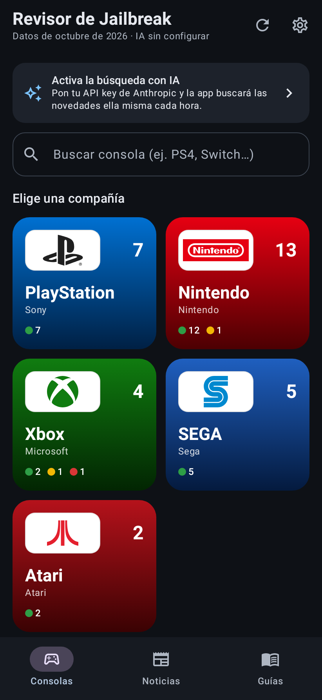
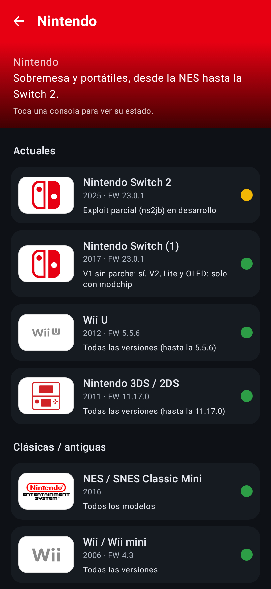
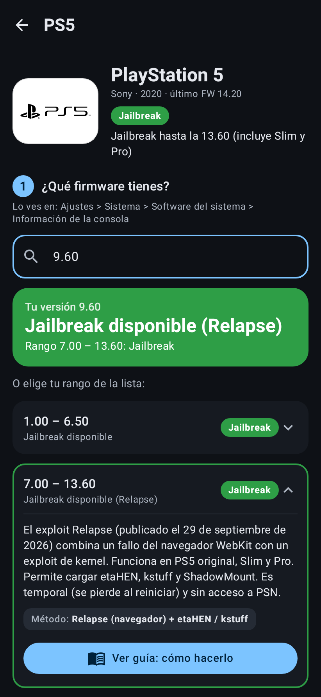
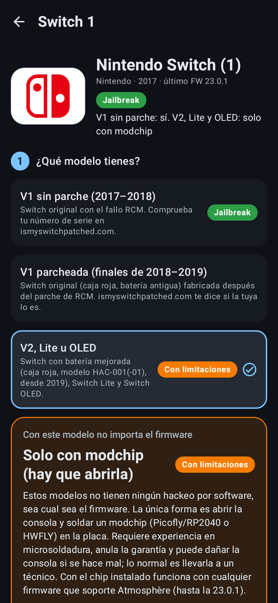
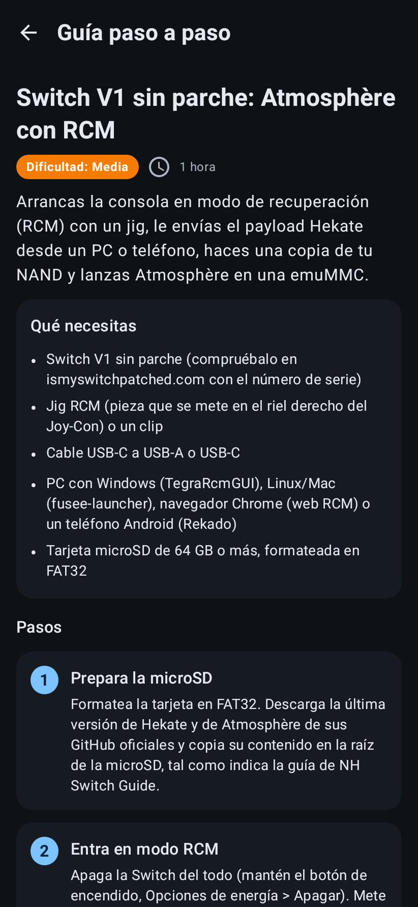

# Revisor de Jailbreak (app Android con IA)

App Android sencilla que te dice si tu consola se puede hackear según la marca, el modelo y el firmware, y te enseña cómo hacerlo con una guía paso a paso. La IA busca las novedades **desde el propio teléfono**, sin servidor: usa Claude (Anthropic) con búsqueda web y tu propia API key.

| Inicio | Nintendo | PS5 + tu versión | Switch V2: solo modchip | Guía paso a paso |
|---|---|---|---|---|
|  |  |  |  |  |

## Cómo funciona

1. **Elige la compañía**: PlayStation, Nintendo, Xbox, SEGA o Atari, también con las consolas antiguas.
2. **Elige la consola**, por ejemplo Nintendo → Switch 2. Cada consola muestra su logo oficial.
3. **La app pregunta solo lo necesario**:
   - **PS1, PS2, NES, Wii…**: todas sus versiones se pueden hackear, así que **no pregunta el firmware**.
   - **Si el modelo importa, pregunta primero el modelo.** Por ejemplo, la **Switch V2, Lite u OLED** muestra directamente **"Solo con modchip, hay que abrirla"**, porque ningún firmware tiene hackeo por software. Solo la V1 parcheada pregunta el firmware.
   - En el resto, muestra la **lista de firmwares** con el color de cada uno al lado. También puedes **escribir tu versión** (por ejemplo `9.60`) para ver directamente el resultado.
4. Junto a cada resultado hay un botón **"Ver guía: cómo hacerlo"** con requisitos, pasos numerados, avisos y enlaces oficiales. Todas las guías están también en la pestaña **Guías**.
5. La pestaña **Noticias** muestra lo que encuentra la IA.

| Color | Significado |
|---|---|
| 🟢 Verde | Hay jailbreak o homebrew público y funcional. |
| 🟠 Naranja | Se puede, con condiciones: abrir la consola y soldar un chip, o solo en ciertos modelos. |
| 🟡 Amarillo | En desarrollo o incompleto (exploit parcial, no publicado o pendiente de actualizar). Siempre lleva una explicación. |
| 🔴 Rojo | No existe ningún método conocido. |

## La IA en el teléfono

En **Ajustes** (icono del engranaje):

1. Pega tu **API key de Anthropic** (se crea en <https://console.anthropic.com/settings/keys>). Al guardarla, la app comprueba que funciona. Se guarda **cifrada con el Android Keystore** y solo se envía a `api.anthropic.com`.
2. Elige el **modelo**: Claude Opus 5.5 (por defecto, la más precisa), Sonnet 5.5 o Haiku 5.5 (más baratas).
3. Elige la **revisión automática**: cada hora (por defecto), cada 3, 6, 12 o 24 horas, o apagada.

Qué hace cada revisión (en segundo plano con WorkManager, solo cuando hay internet):

1. **Escaneo de noticias**: Claude hace unas 5 búsquedas web en fuentes de la escena (GBAtemp, Wololo, PSX-Place, los GitHub de los proyectos, ConsoleMods, hacks.guide…). Guarda las noticias nuevas y decide qué consolas han quedado desactualizadas.
2. **Revisión de consolas**: hasta 2 por ronda. Son las que tienen noticias y las que llevan tiempo sin revisarse (las actuales cada 24 h, las retro cada 30 días). Claude devuelve el estado completo de cada modelo y rango de firmware. También puedes forzarla con **"Revisar esta consola con IA ahora"**.
3. **Validación**: antes de guardar, la app comprueba que las versiones estén en orden, que cada modelo quede cubierto y que los colores y las guías sean válidos. Si algo no cuadra, se conservan los datos anteriores.
4. **Avisos**: si una consola cambia o hay noticias nuevas, recibes una notificación.

Las llamadas usan razonamiento adaptativo y herramientas con esquema estricto. También activan el *fallback* del servidor, que reintenta con otro modelo si el primero rechaza una búsqueda sobre jailbreaks.

**Coste** (en tu cuenta de Anthropic): una búsqueda cuesta unos 0,23 US$ con Opus 5.5, 0,14 US$ con Sonnet 5.5 y 0,06 US$ con Haiku 5.5. Cada hora con Opus sale por unos 8 US$ al día. La pantalla de Ajustes muestra la estimación para tu configuración y el consumo real de la última búsqueda. Para gastar menos, elige otro modelo o revisa cada más horas.

Sin API key la app funciona igual con los datos que lleva incluidos (octubre de 2026).

## Conseguir el APK

- **GitHub Actions**: cada push que toca `jailbreak-checker/` compila la app. En **Actions → Jailbreak Checker**, descarga el artefacto `revisor-jailbreak-apk` e instala `app-release.apk` (hay que permitir "instalar apps desconocidas").
- **En tu PC** (JDK 17+ y Android SDK):

```bash
cd jailbreak-checker/android
./gradlew assembleRelease   # → app/build/outputs/apk/release/app-release.apk
```

Para que las actualizaciones se instalen encima sin desinstalar, firma siempre con la misma clave. Para ello crea los secretos `ANDROID_KEYSTORE_BASE64`, `ANDROID_KEYSTORE_PASSWORD`, `ANDROID_KEY_ALIAS` y `ANDROID_KEY_PASSWORD` en GitHub.

## Estructura

```
jailbreak-checker/
├── data/
│   ├── consoles.json   ← marcas, consolas, modelos y rangos de firmware con su color
│   ├── guides.json     ← guías paso a paso
│   └── logos/          ← logos SVG (Wikimedia Commons, ver CREDITS.md)
├── android/            ← app (Kotlin + Jetpack Compose + SDK de Anthropic para Java)
│   └── app/src/main/java/com/jailbreakchecker/app/
│       ├── ai/         ← prompts, esquemas, validación, búsqueda en segundo plano
│       ├── data/       ← modelos, almacenamiento local, ajustes cifrados
│       └── ui/         ← pantallas
└── docs/               ← capturas
```

`data/` se empaqueta directamente dentro del APK. Para corregir algo a mano, edita `consoles.json` o `guides.json` y compila. Una versión nueva de la app sustituye los datos que la IA había guardado antes de esa versión.

## Tests

```bash
cd jailbreak-checker/android && ./gradlew testDebugUnitTest
```

Incluyen:
- La lógica de versiones y la coherencia de los datos y las guías.
- Una ronda completa de la IA con el SDK real contra una API simulada: cabeceras, *fallback*, búsqueda web, herramientas estrictas, reanudación tras `pause_turn` y lo que se guarda.
- Capturas de las pantallas.

## Aviso

Solo informativo. Modificar una consola puede anular la garantía o provocar baneos online. Usa homebrew y copias de seguridad de juegos que te pertenezcan y respeta las leyes de tu país. Los logos son marcas registradas de sus dueños y se muestran solo para identificar cada consola.
