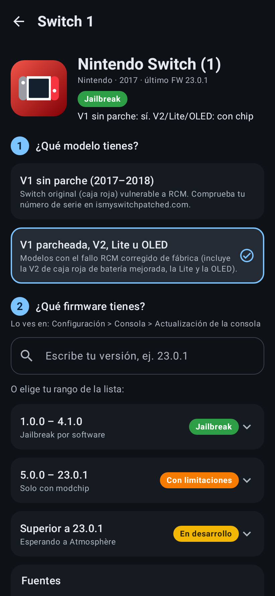
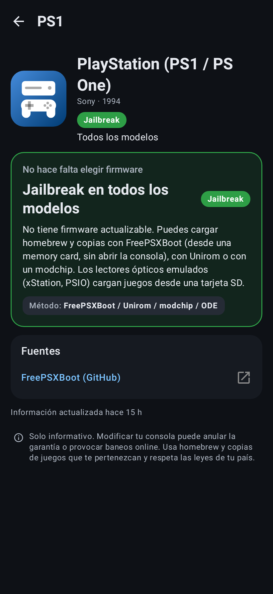

# Revisor de Jailbreak (app Android + Firebase + IA)

App Android sencilla que te dice si tu consola se puede hackear, según la marca, el modelo y el firmware. Un servidor en Firebase usa IA (Claude, con búsqueda web) para revisar las noticias de la escena **cada hora** y actualizar los datos solo.

| Inicio | Nintendo | PS5 + búsqueda de versión | Switch: primero el modelo | PS1: sin preguntar firmware |
|---|---|---|---|---|
|  |  |  |  |  |

## Cómo funciona la app

1. **Elige la compañía**: PlayStation, Nintendo, Xbox, SEGA o Atari (con las consolas antiguas también).
2. **Elige la consola**, por ejemplo Nintendo → Switch 2. Están separadas en "Actuales" y "Clásicas / antiguas".
3. **La app pregunta solo lo necesario**:
   - Si todas las versiones dan igual (PS1, PS2, NES, Wii…), **no pregunta el firmware**: te dice directamente "Todas las versiones".
   - Si el modelo importa (Switch V1 sin parche frente a V2/Lite/OLED, o PS3 compatible o no con CFW), primero pregunta **qué modelo tienes**.
   - Después muestra la **lista de firmwares** con el color justo al lado. También puedes **escribir tu versión** (por ejemplo `9.60`) y la app busca el rango que le corresponde.
4. Al tocar un rango se ve la explicación, el método (GoldHEN, Atmosphère…) y las fuentes.
5. En la pestaña **Noticias** aparecen las novedades que encuentra la IA.

### Colores

| Color | Significado |
|---|---|
| 🟢 Verde | Hay jailbreak o homebrew público y funcional. |
| 🟠 Naranja | Se puede, con condiciones: abrir la consola, soldar un chip o solo ciertos modelos. |
| 🟡 Amarillo | En desarrollo o incompleto (exploit parcial, no publicado o pendiente de actualizar). Siempre lleva una explicación del porqué. |
| 🔴 Rojo | No existe ningún método conocido. |

## Estructura

```
jailbreak-checker/
├── data/consoles.json        ← catálogo inicial (marcas, consolas, rangos y colores)
├── android/                  ← app Android (Kotlin + Jetpack Compose)
├── firebase/
│   ├── firestore.rules       ← la app solo lee; solo el servidor escribe
│   └── functions/            ← función programada cada hora con Claude + búsqueda web
└── docs/                     ← capturas
```

La app lleva una copia de `data/consoles.json`, así que **funciona aunque no haya internet ni Firebase**. Cuando Firebase está configurado, lo que escribe la IA en Firestore sustituye a esos datos en tiempo real.

---

## 1. Conseguir el APK

**Opción A: GitHub Actions (sin instalar nada).** Cada push que toca `jailbreak-checker/` ejecuta el workflow *Jailbreak Checker*. En la pestaña **Actions** de GitHub, abre la última ejecución y descarga el artefacto `revisor-jailbreak-apk`. Dentro está `app-release.apk`: pásalo al teléfono e instálalo (hay que permitir "instalar apps desconocidas").

**Opción B: compilar en tu PC.** Necesitas el JDK 17 o posterior y el Android SDK (Android Studio los instala):

```bash
cd jailbreak-checker/android
./gradlew assembleRelease   # → app/build/outputs/apk/release/app-release.apk
```

> Sin `google-services.json` el APK funciona en **modo sin conexión**, solo con los datos incluidos. Para las actualizaciones automáticas, sigue el paso 2.

## 2. Conectar con tu Firebase

Necesitas el **plan Blaze**, que es obligatorio para Cloud Functions y Secret Manager.

1. En la [consola de Firebase](https://console.firebase.google.com), abre tu proyecto y entra en **Añadir app → Android**, con el paquete `com.jailbreakchecker.app`.
2. Descarga `google-services.json` y haz una de estas dos cosas:
   - Cópialo a `jailbreak-checker/android/app/google-services.json` (está en `.gitignore`, no se sube), o
   - en GitHub ve a **Settings → Secrets and variables → Actions** y crea el secreto `GOOGLE_SERVICES_JSON` con el contenido del archivo. El workflow lo usará al compilar.
3. En **Firestore Database**, crea la base de datos (modo producción; las reglas se despliegan en el paso 3).

## 3. Activar la IA que revisa cada hora

1. Crea una API key de Anthropic en <https://console.anthropic.com> (tiene un coste por uso; abajo hay una estimación).
2. Instala Firebase CLI y despliega:

```bash
npm install -g firebase-tools
firebase login

cd jailbreak-checker/firebase
firebase use --add                       # elige tu proyecto (crea .firebaserc)
firebase functions:secrets:set ANTHROPIC_API_KEY   # pega tu API key

cd functions && npm ci && cd ..
firebase deploy --only functions,firestore
```

En el primer despliegue la CLI te preguntará los parámetros. Con pulsar Enter se usan los valores por defecto (los de la tabla de abajo).

3. **La primera ejecución** carga el catálogo en Firestore y empieza a revisar. Para no esperar a la siguiente hora, ve a Google Cloud Console → **Cloud Scheduler** → `firebase-schedule-hourlyJailbreakCheck-…` → **Forzar ejecución**, o ejecuta:

```bash
gcloud scheduler jobs run firebase-schedule-hourlyJailbreakCheck-us-central1 --location us-central1
```

Los registros se ven con `firebase functions:log`.

### Qué hace el servidor cada hora

1. **Escanea noticias**: Claude busca en la web (GBAtemp, Wololo, PSX-Place, GitHub de los proyectos, ConsoleMods, hacks.guide, prensa de videojuegos…) y las compara con lo que muestra la app. Las novedades se guardan en `news`, que es lo que aparece en la pestaña Noticias.
2. **Revisa consolas**: si una noticia cambia algo, o si una consola lleva tiempo sin revisarse (las actuales cada 24 h, las retro cada 30 días), Claude investiga esa consola y devuelve sus rangos de firmware completos.
3. **Valida antes de guardar**: versiones en orden, modelos existentes, colores válidos. Si algo no cuadra, se conservan los datos anteriores. Cada cambio se registra en `consoles/{id}/history`.
4. Escribe la hora de la última revisión en `meta/status`; la app la muestra arriba ("IA revisó las noticias hace X min").

### Parámetros y coste

| Parámetro | Por defecto | Qué controla |
|---|---|---|
| `CLAUDE_MODEL` | `claude-opus-5-5` | Modelo de IA |
| `SCAN_EFFORT` / `REVIEW_EFFORT` | `medium` / `high` | Cuánto "piensa" la IA en el escaneo y en las revisiones |
| `SCAN_MAX_SEARCHES` / `REVIEW_MAX_SEARCHES` | `5` / `5` | Búsquedas web por llamada |
| `MAX_REVIEWS_PER_RUN` | `2` | Revisiones detalladas como máximo por hora |

Se cambian en `firebase/functions/.env.<tu-proyecto>` y se aplican con `firebase deploy --only functions`.

**Estimación aproximada** con los valores por defecto: unos 0,20–0,30 US$ por escaneo horario más unas 10 revisiones al día. En total, **unos 8–10 US$ al día (≈ 250–300 US$ al mes)** en la API de Anthropic. Firebase (Functions + Firestore) apenas añade coste con este uso. Las cifras dependen del tamaño real de las búsquedas, así que revisa el consumo en console.anthropic.com los primeros días. Para gastar menos:

- `CLAUDE_MODEL=claude-sonnet-5-5` cuesta aproximadamente la mitad por token.
- `SCAN_EFFORT=low` y `SCAN_MAX_SEARCHES=3`.
- Revisar cada 2 o 3 horas: cambia `schedule: "every 60 minutes"` en `functions/src/index.ts`.

## Editar los datos a mano

Edita `data/consoles.json`. Para añadir una consola, copia otra como plantilla: `mode: "all"` si todas las versiones comparten estado, o `mode: "firmware"` con su lista `firmwares`. Para que Firestore reciba tus cambios, **sube `seedVersion`** y vuelve a desplegar. Las consolas que la IA ya actualizó después conservan sus datos más recientes.

## Tests

```bash
cd jailbreak-checker/android && ./gradlew testDebugUnitTest   # lógica de versiones, datos y capturas de pantalla
cd jailbreak-checker/firebase/functions && npm test           # validación de las respuestas de la IA
```

## Aviso

Esta app es solo informativa. Modificar una consola puede anular la garantía o provocar baneos online. Usa homebrew y copias de seguridad de juegos que te pertenezcan y respeta las leyes de tu país.
